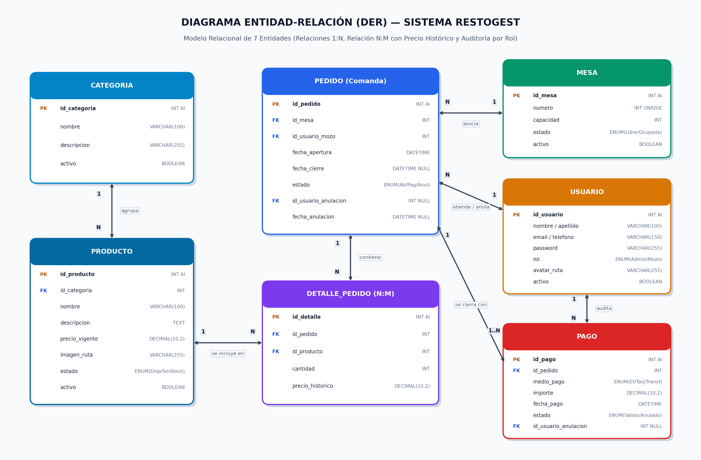
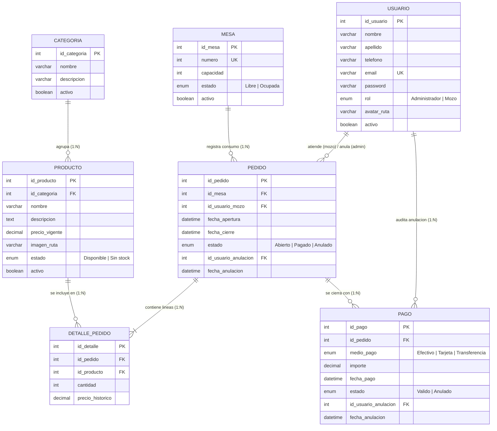

# TP-Final-Restaurante
trabajo final de laboratorio 2 , narrativa de restaurante

👥 Equipo de Desarrollo 

Pereyra Elías

Peláez Víctor

Lagos Maximiliano


# 🍽️ RestoGest — Sistema de Gestión Integral de Restaurante

**RestoGest** es una aplicación web cliente-servidor (Web API REST en **.NET 10 + Entity Framework Core + MySQL** y SPA reactiva en **Vue.js 3 + Vite + Axios**) diseñada para informatizar la gestión de salones gastronómicos, toma de comandas en tiempo real, control de stock de carta, facturación y auditoría administrativa.

## 🎯 Problema que Resuelve

En la operación diaria de un restaurante, el manejo manual de comandas en papel y el control descentralizado de precios o disponibilidad de platos provocan:
- Apertura duplicada de mesas ya ocupadas o pérdida de ítems consumidos.
- Inconsistencias en facturaciones históricas cuando cambia el precio de un producto del menú.
- Ofrecimiento de platos agotados ("Sin stock") por falta de sincronización entre cocina/administración y los mozos.
- Falta de trazabilidad y auditoría ante anulaciones de tickets o cobros.

**RestoGest** resuelve estos problemas centralizando:
1. **Control del Salón en Vivo**: Validación automática para impedir abrir comandas en mesas ocupadas, cálculo de tiempo de ocupación y subtotal acumulado en vivo.
2. **Búsqueda Asíncrona AJAX de Platos Disponibles**: Al cargar ítems en una comanda, el mozo busca platos por nombre o categoría en tiempo real contra el servidor sin descargar todo el menú ni mostrar productos suspendidos ("Sin stock").
3. **Resguardo de Precio Histórico**: Cada `DETALLE_PEDIDO` almacena el `precio_historico` vigente al instante de pedir, garantizando que futuros aumentos de precios no alteren comandas ni cierres de caja pasados.
4. **Seguridad por Roles y Auditoría Lógica**: Autenticación mediante **JWT (JSON Web Tokens)**. Ningún registro se elimina físicamente de MySQL: las bajas son lógicas (`activo = false`) y las anulaciones de pedidos o pagos quedan restringidas exclusivamente al rol **Administrador**, registrando fecha, hora e identificador del administrador responsable (`id_usuario_anulacion`, `fecha_anulacion`).

## 🗂️ Diagrama de Entidad-Relación (DER) y Modelo de Datos

El modelo persiste **7 entidades principales** interrelacionadas en MySQL (`Scripts/init_db.sql`):
- **Relaciones `1:N`**:
  - `CATEGORIA (1) ─── (N) PRODUCTO`
  - `MESA (1) ─── (N) PEDIDO`
  - `USUARIO (1) ─── (N) PEDIDO` (como mozo que atiende y como administrador que audita una anulación)
  - `PEDIDO (1) ─── (1..N) PAGO`
- **Relación `N:M` (Entidad Asociativa dependiente de dos entidades)**:
  - `DETALLE_PEDIDO` relaciona `PEDIDO` con `PRODUCTO`, registrando `cantidad` y `precio_historico`.





## ✅ Matriz de Evidencias de Requerimientos Mínimos

| # | Requerimiento Técnico / Narrativa | Estado | Evidencia en Backend (.NET / MySQL) | Evidencia en Frontend (Vue.js 3 SPA) |
| :- | :--- | :---: | :--- | :--- |
| **1** | **Modelo de Datos y Persistencia**: Mínimo 6 clases/tablas relacionadas (`1:N` y `N:M` / entidad dependiente de otras dos). | ✅ Cumplido | **7 Tablas y Modelos EF Core**: `Categoria`, `Producto` (`1:N`), `Mesa`, `Usuario`, `Pedido` (depende de `Mesa` + `Usuario`), `DetallePedido` (`N:M` entre `Pedido` y `Producto` con `precio_historico`), `Pago`. Ver `Scripts/init_db.sql`, `RestoGestAPI/Data/DataBaseContext.cs` y `RestoGestAPI/Models/*.cs`. | Consumo tipado en todas las vistas (`AdminView.vue`, `MozoView.vue`, `InformesView.vue`, `PerfilView.vue`). |
| **2.a** | **Seguridad, Autenticación y Roles**: Login/Logout funcional y protección en Backend y Frontend. | ✅ Cumplido | `RestoGestAPI/Controllers/AuthController.cs` (`POST /api/auth/login`, `GET /api/auth/me`) genera JWT con claims `NameIdentifier`, `Email` y `Role` (`Administrador` / `Mozo`). Configuración en `Program.cs`. | `frontend/src/views/Login.vue`, `frontend/src/components/Navbar.vue` (Logout) y guardia `router.beforeEach` en `frontend/src/router/index.js`. |
| **2.b** | **Funcionalidad Exclusiva por Rol**: Anulación lógica con auditoría e informes/ABM exclusivos para `Administrador`. | ✅ Cumplido | `[Authorize(Roles = "Administrador")]` en: `POST /api/pedidos/{id}/anular`, `POST /api/pagos/{id}/anular`, `GET /api/informes/auditoria-anulaciones`, y ABMs de `CategoriasController`, `ProductosController`, `MesasController` y `UsuariosController`. Registra `IdUsuarioAnulacion` y `FechaAnulacion`. | Botón **"Anular (Admin)"** en `MozoView.vue`, panel completo `/admin` (`AdminView.vue`) y pestaña **5. Auditoría de Anulaciones** en `InformesView.vue` visibles y accesibles sólo para rol `Administrador`. |
| **2.c** | **Gestión de Avatar Personalizado** en el perfil de usuario. | ✅ Cumplido | `PUT /api/usuarios/perfil` en `RestoGestAPI/Controllers/UsuariosController.cs` procesa `IFormFile? Avatar`, guarda el archivo en `wwwroot/uploads/avatars/` y actualiza `USUARIO.avatar_ruta`. | `frontend/src/views/PerfilView.vue` (formulario `multipart/form-data` con previsualización circular en `Navbar.vue` y `PerfilView.vue`). |
| **3** | **Manejo de Archivos en el Servidor** adicional al avatar del usuario. | ✅ Cumplido | `POST /api/productos` y `PUT /api/productos/{id}` en `RestoGestAPI/Controllers/ProductosController.cs` procesan `IFormFile? Imagen`, almacenan la foto del plato en `wwwroot/uploads/productos/` y persisten la ruta en `PRODUCTO.imagen_ruta`. Servido mediante `app.UseStaticFiles()`. | Alta y edición de productos con input de imagen y miniatura en catálogo (`frontend/src/views/AdminView.vue`) y en buscador de comandas (`MozoView.vue`). |
| **4** | **Módulo SPA / AJAX con Vue.js**: Al menos un ABM/CRUD completo reactivo vía AJAX/JSON sin recargar la página. | ✅ Cumplido | Endpoints REST JSON en `ProductosController.cs`, `CategoriasController.cs`, `MesasController.cs` y `UsuariosController.cs`. | `frontend/src/views/AdminView.vue` implementa 4 ABMs reactivos completos (Productos con cambio de stock instantáneo, Categorías, Mesas y Usuarios) vía Axios sin recargar la página. |
| **5** | **Paginado por Servidor (Server-Side Pagination)** en los listados principales. | ✅ Cumplido | Implementado con `.Skip((page - 1) * pageSize).Take(pageSize)` y metadatos `{ items, totalItems, page, pageSize, totalPages }` en `GET /api/pedidos` (`PedidosController.cs`), `GET /api/productos` (`ProductosController.cs`), `GET /api/categorias`, `GET /api/pagos` y `GET /api/usuarios`. | Controles de paginación de servidor (`← Anterior` / `Siguiente →`) en el Historial de Pedidos (`MozoView.vue`) y en los listados de Productos, Categorías y Usuarios (`AdminView.vue`). |
| **6** | **Búsqueda Asíncrona de Entidades Relacionadas (AJAX)** sin `<select>` masivo. | ✅ Cumplido | `GET /api/productos/buscar?q=...&idCategoria=...` en `ProductosController.cs` filtra en base de datos con `Contains(q)` únicamente productos con `Activo == true` y `Estado == "Disponible"` (máx. 15 registros por consulta). | En `frontend/src/views/MozoView.vue`, al cargar ítems en una comanda abierta, el buscador ejecuta `buscarProductosAsync()` con *debounce* de 250ms a medida que el mozo tipea el nombre del plato. |
| **7** | **Web API REST con JWT + Colección de Pruebas**. | ✅ Cumplido | Todos los controladores protegidos con `[Authorize]` y portador `Bearer <JWT>`. Interceptor Axios en `frontend/src/api/axios.js`. | Colecciones de prueba incluidas en el repositorio: `RestoGestAPI/RestoGestAPI.http` (15 pruebas listas para VS Code / Visual Studio) y `docs/RestoGest.postman_collection.json` (Postman). |
| **8** | **5 Informes de Gestión y Auditoría** solicitados en la Narrativa. | ✅ Cumplido | `RestoGestAPI/Controllers/InformesController.cs`: 1) `productos-por-categoria`, 2) `mas-vendidos?dias=X`, 3) `mesas-ocupadas`, 4) `recaudacion?desde=&hasta=`, 5) `auditoria-anulaciones`. | Vista interactiva `frontend/src/views/InformesView.vue` con las 5 pestañas de reportes y filtros dinámicos. |

## 🚀 Instrucciones de Instalación y Ejecución Rápida

### 1. Base de Datos MySQL
1. Asegúrese de tener **MySQL / MariaDB** ejecutándose en el puerto `3306`.
2. Ejecute el script completo ubicado en `Scripts/init_db.sql` (crea el esquema `restogest_db`, las **7 tablas** y carga datos semilla de prueba).
3. Verifique la cadena de conexión en `RestoGestAPI/appsettings.json`:
   ```json
   "ConnectionStrings": {
     "DefaultConnection": "Server=127.0.0.1;Database=restogest_db;Uid=root;Pwd=;"
   }
   ```

### 2. Backend (.NET Web API)
```bash
cd RestoGestAPI
dotnet restore
dotnet run
```
El servidor quedará escuchando en `http://localhost:5041` (y también en `http://localhost:7000`).

### 3. Frontend (Vue.js 3 + Vite)
```bash
cd frontend
npm install
npm run dev
```
Abra en el navegador `http://localhost:5173`.

## 🔑 Credenciales de Prueba (Seed Inicial)

| Rol | Email | Contraseña | Permisos Principales |
| :--- | :--- | :--- | :--- |
| **Administrador** | `admin@restogest.com` | `123456` | Acceso total: ABM de Productos (con foto), Categorías, Mesas y Usuarios; Salón de Comandas; **Anulación lógica** de Pedidos/Pagos; **Informe de Auditoría** y Perfil con Avatar. |
| **Mozo (Empleado)** | `mozo@restogest.com` | `123456` | Visualización de Salón, apertura de mesas libres, carga de comandas con búsqueda AJAX, cobro de pedidos, informes operativos y edición de su propio Perfil/Avatar. |
